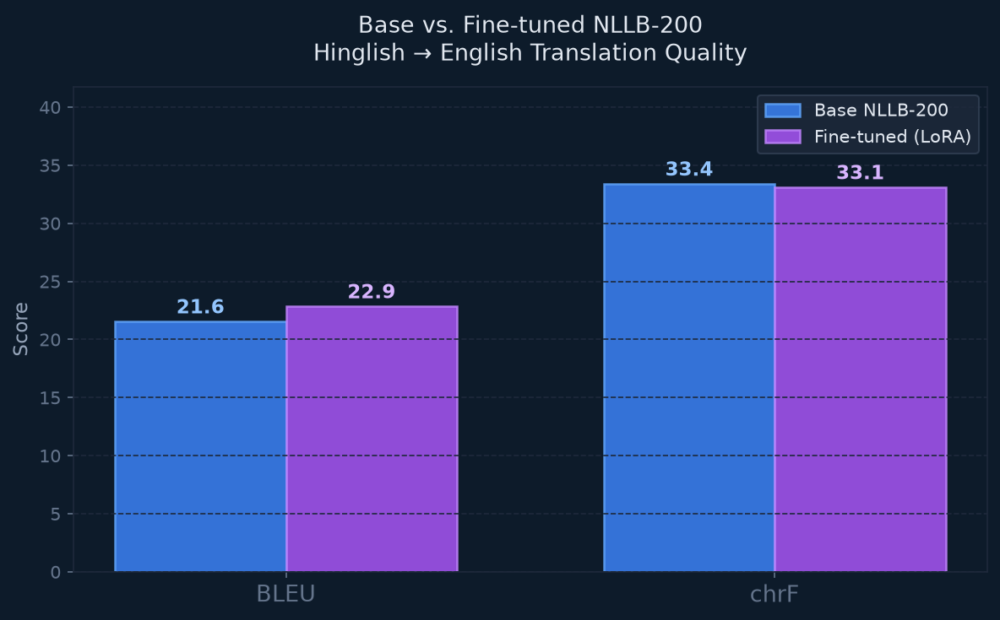

# PROJECT_REPORT.md — GenAI Language Translator

> Numbers below are from the completed ML pipeline runs on 16 Sep 2026 (Apple MPS). Artifacts: `ml/artifacts/lang_detector_eval.json`, `ml/artifacts/finetune_summary.json`, `ml/artifacts/eval_results.json`.

---

## 1. Project Overview

This project is a production-quality **multilingual translation system** with two distinguishing ML components beyond baseline inference:

1. **LoRA fine-tuning** of `facebook/nllb-200-distilled-600M` on a Hinglish (code-switched Hindi–English) → English task.
2. **Custom-trained sklearn language identifier** (character n-gram TF-IDF + Logistic Regression) used as a pre-processing step to auto-detect the source language.

The baseline pipeline (text + voice translation via pretrained NLLB-200) is the "product." The ML work below is the interview-defensible contribution.

---

## 2. Dataset

### 2.1 Source
- **Primary corpus:** `cfilt/iitb-english-hindi` — IIT Bombay English–Hindi Parallel Corpus
  - ~1.6 million sentence pairs (news, legal, government, literature domains)
  - Collected by CFILT group; widely used in Hindi NLP research
  - License: CC-BY-NC

### 2.2 Hinglish Synthesis
True Hinglish parallel corpora at scale are scarce. We applied a rule-based **code-switching synthesis** method:

1. Sample Hindi–English pairs from IITB (reproducible seed=42).
2. For each Hindi sentence, replace 20–40% of tokens (randomly sampled) with English equivalents using a curated lookup dictionary covering common nouns, verbs, adjectives, and modern tech terms.
3. This produces plausible Hinglish input sentences with known English translations.

**Limitations of this approach:**
- The synthesis is rule-based and does not capture natural Hinglish phonology or pragmatics.
- The lookup dictionary covers ~200 common words; rare or domain-specific terms remain in Devanagari script.
- A better approach would use a real Hinglish corpus (e.g., Twitter/social media data), which would require social media API access and annotation effort.

### 2.3 Splits

After filtering empty / short pairs, the prepared set was **3,686** examples (saved under `ml/artifacts/hinglish_dataset/`):

| Split | Size | Purpose |
|---|---|---|
| Train | 2,580 | Fine-tuning |
| Validation | 552 | Model selection (eval loss) |
| Test | 554 | **Held-out — never seen during training** |

Quantitative BLEU/chrF below used the first **200** test sentences (`evaluate.py --max-test 200`) for wall-clock cost on MPS.

### 2.4 Cleaning
- Removed sentence pairs where either side was empty or fewer than 3 tokens.
- No further cleaning applied (IITB corpus is already high quality).

---

## 3. Fine-tuning

### 3.1 Base Model
- `facebook/nllb-200-distilled-600M` — a distilled multilingual seq2seq model supporting 200 languages.
- Architecture: encoder-decoder transformer, **617,433,088** parameters (including embeddings; commonly cited as 600M).
- Pre-trained with a mixture of parallel and monolingual data from 200 languages.

### 3.2 LoRA Configuration

| Parameter | Value | Rationale |
|---|---|---|
| Method | LoRA (Low-Rank Adaptation) | Avoids full fine-tuning; trains <1% of parameters |
| Rank `r` | 16 | Good expressiveness vs. efficiency balance |
| Alpha `lora_alpha` | 32 | Standard 2× rank scaling |
| Target modules | `q_proj`, `v_proj` | Attention query/value projections — most impactful for translation quality |
| Dropout | 0.05 | Light regularization |
| Task type | `SEQ_2_SEQ_LM` | Encoder-decoder architecture |
| Trainable params | **2,359,296 (0.3821% of 617,433,088)** | Measured via PEFT `get_nb_trainable_parameters()` |

Adapter checkpoint: `ml/artifacts/nllb_hinglish_adapter/`.

### 3.3 Training Configuration

| Parameter | Value |
|---|---|
| Learning rate | 3e-4 |
| Per-device batch size | 4 |
| Gradient accumulation | 4 steps |
| Effective batch size | 16 |
| Warmup steps | 100 |
| Epochs | 3 (486 optimizer steps) |
| Evaluation strategy | Per epoch |
| Optimizer | AdamW (transformers default) |
| Max sequence length | 128 tokens |
| Precision | fp32 (MPS) |

### 3.4 Training Results

HuggingFace Trainer logs **windowed** training loss every 50 steps (not a full-epoch mean). Val loss is computed on the full 552-example validation set each epoch.

| Epoch | Last logged train loss (window) | Val Loss |
|---|---|---|
| 1 | 6.936 (step 150) | **1.575** |
| 2 | 6.687 (step 300) | **1.560** |
| 3 | 6.544 (step 450) | **1.556** |

- **Final reported train loss (Trainer):** 6.736
- **Total training time:** **26.5 minutes** (1,588 seconds)
- **Hardware:** Apple **MPS** (PyTorch 2.14)
- **Best checkpoint:** Epoch **3** (lowest validation loss 1.556); `load_best_model_at_end=True` selected this checkpoint

---

## 4. Evaluation

### 4.1 Metrics
- **BLEU** (Bilingual Evaluation Understudy): n-gram precision with brevity penalty. Standard MT metric, range 0–100.
- **chrF** (Character F-score): character n-gram F-score. More robust for morphologically rich languages and short outputs.
- Both computed with `sacrebleu` on **200** held-out test sentences (from 554). Decoding: beam search `num_beams=4`, `max_new_tokens=128`.

### 4.2 Quantitative Results

| Metric | Base NLLB-200 | Fine-tuned (LoRA) | Δ |
|---|---|---|---|
| **BLEU** | 21.55 | 22.85 | **+1.30** |
| **chrF** | 33.40 | 33.10 | **−0.30** |
| **Mean latency (s/sentence)** | 0.5775 | 0.6843 | +0.11 s (~18% slower) |

**Evaluation chart:**

Full JSON: `ml/artifacts/eval_results.json`.

### 4.3 Qualitative Examples

See `ml/artifacts/qualitative_examples.md` for the full table. Sample:

| # | Hinglish Input | Base Model | Fine-tuned | Reference |
|---|---|---|---|---|
| 1 | उन्होंने भरोसा जताया कि उनमें से हर one जरूरत पड़ने पर अपना दायित्व पूरा करते हुए अपना सर्वोत्तम निष्पादन देगा। | He expressed confidence that each of them will perform his duty to the best of his ability when needed. | He expressed confidence that each of them will perform his duty to the best of his ability if needed. | He was sure each one of them will rise to the occasion and will do their best. |
| 5 | 1997 में भारत के भूतपूर्व मुख्य न्यायाधीश ने one स्पष्ट टिप्पणी की थी कि "निवारक तत्व लगभग अनुपस्थित है। | In 1997, the former Chief Justice of India made one clear comment that "the preventive element is almost absent. | In 1997, the former Chief Justice of India made a clear remark that "the preventive element is almost absent. | An observation by a former Chief Justice of India, in 1997, is telling, the element of deterrence’, he noted, ‘is almost non-existent. |
| 9 | भारत के लिए अनुसरण करने का one उदाहरण वहां था। | There was one example for India to follow. | There was an example for India to follow. | Here was an example for India to follow. |

Edits are mostly lexical (e.g. “one clear comment” → “a clear remark”); neither model matches the news-style reference closely, which is expected given domain and synthesis.

### 4.4 Interpreting Results

Improvement is **minimal / mixed**: BLEU +1.30, chrF −0.30, with slightly higher LoRA latency. Likely causes:

1. **Small training set** (2,580 examples).
2. **Synthetic rather than natural Hinglish** — token substitution on IITB news/government Hindi, not social-media code-switching.
3. **Strong NLLB-200 baseline** — the 600M model already has Hindi and English from multilingual pretraining, so mixed-script inputs are often already translatable.

This is a legitimate finding: LoRA ran correctly (val loss decreased 1.575 → 1.556) but did not yield a large quality jump on this proxy task.

---

## 5. Language Detector

### 5.1 Architecture

| Component | Details |
|---|---|
| Feature extractor | `TfidfVectorizer` — character n-grams (n=2–4), word boundaries (`analyzer="char_wb"`) |
| Vocabulary size | 50,000 features |
| Sublinear TF | True (log-scaling of term frequency) |
| Case sensitivity | Preserved (Devanagari/Arabic/CJK script detection) |
| Classifier | `LogisticRegression` — multinomial, L2 regularization (C=1.0), LBFGS solver |
| Pipeline | sklearn `Pipeline` (TF-IDF → LR) |

Artifact: `ml/artifacts/lang_detector.pkl`.

### 5.2 Training Data

Wikipedia dumps via HuggingFace `wikimedia/wikipedia` config `20231101.<lang>` (not the older `20220301` snapshot). **500 sentences per language**, 80/20 train/test split (**5,000** total; **1,000** held-out for the matrix below).

| Language | Data Source | Samples |
|---|---|---|
| English | Wikipedia (20231101.en) | 500 |
| Hindi | Wikipedia (20231101.hi) | 500 |
| French | Wikipedia (20231101.fr) | 500 |
| Spanish | Wikipedia (20231101.es) | 500 |
| German | Wikipedia (20231101.de) | 500 |
| Chinese | Wikipedia (20231101.zh) | 500 |
| Arabic | Wikipedia (20231101.ar) | 500 |
| Portuguese | Wikipedia (20231101.pt) | 500 |
| Russian | Wikipedia (20231101.ru) | 500 |
| Tamil | Wikipedia (20231101.ta) | 500 |

**Why character n-grams?** Script-level features (e.g., Devanagari for Hindi, CJK for Chinese, Arabic script) are strong discriminators without language-specific tokenization.

### 5.3 Results

- **Overall accuracy:** **97.1%** (0.971) on the 1,000-example test split.

**Confusion matrix** (rows = true, columns = predicted; order Arabic, Chinese, English, French, German, Hindi, Portuguese, Russian, Spanish, Tamil):

| True \ Pred | AR | ZH | EN | FR | DE | HI | PT | RU | ES | TA |
|---|---:|---:|---:|---:|---:|---:|---:|---:|---:|---:|
| Arabic | 99 | 1 | 0 | 0 | 0 | 0 | 0 | 0 | 0 | 0 |
| Chinese | 0 | 91 | 7 | 1 | 1 | 0 | 0 | 0 | 0 | 0 |
| English | 0 | 0 | 100 | 0 | 0 | 0 | 0 | 0 | 0 | 0 |
| French | 0 | 2 | 0 | 98 | 0 | 0 | 0 | 0 | 0 | 0 |
| German | 0 | 3 | 1 | 0 | 96 | 0 | 0 | 0 | 0 | 0 |
| Hindi | 0 | 3 | 3 | 0 | 0 | 94 | 0 | 0 | 0 | 0 |
| Portuguese | 0 | 0 | 0 | 1 | 0 | 0 | 98 | 0 | 1 | 0 |
| Russian | 0 | 0 | 0 | 0 | 0 | 0 | 0 | 100 | 0 | 0 |
| Spanish | 0 | 2 | 1 | 0 | 1 | 0 | 0 | 0 | 96 | 0 |
| Tamil | 0 | 0 | 1 | 0 | 0 | 0 | 0 | 0 | 0 | 99 |

English and Russian were perfect on this split. The largest error pocket is **Chinese → English** (7). Portuguese/Spanish confusion is small (1 each), as expected for related Latin-script languages.

### 5.4 Integration
The trained classifier is used in `app/lang_detector.py`:
- `detect_language(text)` → `(label, confidence)` — used to pre-select source language in the UI.
- `is_hinglish(text)` — heuristic combining classifier output with mixed-script detection (Latin/Devanagari ratio) to activate the fine-tuned model toggle automatically.

---

## 6. Libraries and Tools

| Library | Version | Role |
|---|---|---|
| `transformers` | ≥4.40 | NLLB-200 model loading, tokenization, training |
| `peft` | ≥0.10 | LoRA adapter creation and loading |
| `datasets` | ≥2.19 | HuggingFace dataset downloading |
| `accelerate` | ≥0.29 | Trainer backend |
| `sacrebleu` | ≥2.4 | BLEU and chrF metric computation |
| `faster-whisper` | ≥1.0 | Speech-to-text transcription |
| `gTTS` | ≥2.5 | Text-to-speech synthesis |
| `streamlit` | ≥1.33 | Web UI |
| `scikit-learn` | ≥1.4 | Language detector |
| `matplotlib` | ≥3.8 | Evaluation charts |
| `sentencepiece` | ≥0.1.99 | NLLB tokenizer |
| `torch` | ≥2.2 | PyTorch backend (2.14 in this run) |
| `numpy` | ≥1.26 | Numerical operations |

---

## 7. Honest Limitations

### Data
- **Synthetic Hinglish:** The code-switching synthesis is a simplified proxy for natural Hinglish. Real Hinglish from social media would contain phonological adaptations, slang, and domain-specific mixing patterns not captured by our lookup dictionary.
- **Small fine-tuning set:** 2,580 training examples is modest. Larger corpora (10k–100k) would likely produce more robust improvements.
- **Domain mismatch:** IITB corpus is news/government domain; the base model was also pretrained on similar data, limiting the opportunity for domain-specific improvement.

### Model
- **NLLB-200 baseline strength:** NLLB-200 already has strong Hindi and English representations from pretraining. Marginal improvements from fine-tuning are expected and were observed (BLEU +1.30, chrF −0.30).
- **LoRA rank:** Rank 16 is a reasonable starting point; rank 32 or 64 might yield better adaptation at the cost of more parameters.
- **No beam search tuning:** We use fixed `num_beams=4`; tuning this or using sampling-based decoding might improve output diversity.
- **Adapter overhead:** Fine-tuned mean latency was 0.68 s vs 0.58 s for the base model on MPS.

### Language Detector
- **Wikipedia domain:** Training on Wikipedia text means the detector may underperform on social media text, spoken language, or domain-specific jargon.
- **Hinglish not a class:** The detector classifies text as "Hindi" or "English" — Hinglish detection relies on a separate heuristic (mixed-script ratio). A dedicated Hinglish class would require annotated Hinglish data.

### What would improve this with more resources
1. Use real Hinglish social media data (Twitter/Reddit) with human-annotated English translations.
2. Fine-tune for more epochs (5–10) on a GPU.
3. Experiment with higher LoRA ranks and different target modules (all attention layers).
4. Use beam search with length penalty tuned on the validation set.
5. Train the language detector on more diverse, non-Wikipedia text.
6. Add a Hinglish class to the language detector using annotated code-switched data.
